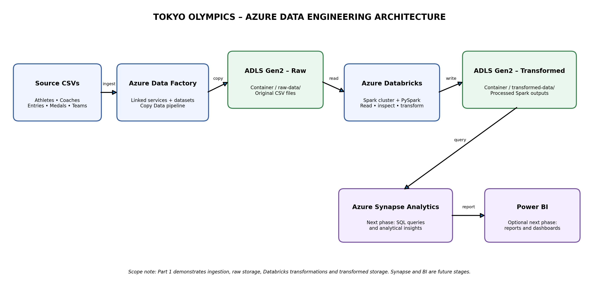

# Tokyo Olympics Data Analytics -- Azure Data Engineering Project

<p align="center">
  <strong>End-to-end batch data engineering pipeline using Microsoft Azure, Azure Data Factory, ADLS Gen2 and Azure Databricks (PySpark)</strong>
</p>

<p align="center">
  
</p>

## 1. Project Overview

This project demonstrates a cloud-based data engineering workflow using
the Tokyo 2020 Olympics dataset (the event was held in 2021). The
objective is to ingest source CSV files, store the original data in
Azure Data Lake Storage Gen2, process the data with PySpark in Azure
Databricks, and write the transformed datasets back to the data lake.

The workflow follows the **ETL (Extract, Transform, Load)** pattern:

1.  **Extract:** Obtain the Olympics CSV datasets from the project data
    source.
2.  **Load -- raw:** Use Azure Data Factory (ADF) to copy source files
    into the raw area of ADLS Gen2.
3.  **Transform:** Use Azure Databricks and Apache Spark to read,
    inspect, clean and transform the raw data.
4.  **Load -- transformed:** Write processed datasets to a separate
    transformed area in ADLS Gen2.
5.  **Analyze -- next phase:** Use Azure Synapse Analytics to query
    transformed data. A dashboard can optionally be created using Power
    BI.

> **Scope accuracy:** The Part 1 walkthrough available for this project
> demonstrates ingestion, raw storage, Databricks processing and
> transformed storage. Synapse SQL analysis and dashboarding are
> described as subsequent stages, but are not demonstrated as completed
> in that walkthrough. Update this README when you implement and test
> those stages yourself.

## 2. Business Objective

The Olympics data can be used to explore questions such as:

-   Which countries won the most gold, silver, bronze and total medals?
-   Which disciplines had the highest number of participating athletes?
-   What was the male/female participation split across disciplines?
-   Which countries and teams participated in each event?
-   How can raw CSV data be organized and prepared for downstream
    analytics?

The main learning objective is to build and understand the data
pipeline---not to claim a production-grade analytics platform.

## 3. Dataset

The source material describes five CSV datasets:

  -----------------------------------------------------------------------
  Dataset                             Description
  ----------------------------------- -----------------------------------
  `athletes.csv`                      Athlete name, country and
                                      discipline

  `coaches.csv`                       Coach name, country, discipline and
                                      event

  `entries_gender.csv`                Male, female and total entries by
                                      discipline

  `medals.csv`                        Country medal counts (gold, silver,
                                      bronze, total) and rank

  `teams.csv`                         Team, country, discipline and event
                                      information
  -----------------------------------------------------------------------

The walkthrough describes approximately 11,000 athletes, 47 disciplines
and 743 teams. Counts can vary depending on the dataset version.

**Check the exact filenames in your local `datasets/` folder.** If your
filenames differ, update this table and the paths used by your pipeline.

Dataset handling: - Keep original source files unchanged in
`datasets/`. - Review the dataset's original license and attribution
requirements before redistribution. - Do not commit credentials,
connection strings, access keys, client secrets or personal data.

## 4. Solution Architecture

The architecture image at the top shows the pipeline. Its stages are:

### Stage 1 -- Source datasets

Five Olympics CSV files are the input. In the walkthrough, the source
files are hosted in GitHub and accessed by Azure Data Factory. This
repository also keeps a copy under `datasets/` for reference and local
inspection.

### Stage 2 -- Azure Data Factory (ingestion)

Azure Data Factory is the orchestration and data movement service.

Typical ADF components: - **Linked service:** Defines the connection to
the source and Azure storage account. - **Source dataset:** Describes
the input CSV location and format. - **Sink dataset:** Describes the
ADLS Gen2 destination path and format. - **Copy Data activity:** Copies
source files to the data lake. - **Pipeline:** Groups and runs the copy
activities.

Expected result: source CSV files are available in the raw data area of
ADLS Gen2.

### Stage 3 -- ADLS Gen2 (raw layer)

ADLS Gen2 provides scalable cloud storage with a hierarchical namespace.
A container is created in the storage account, with separate directories
for raw and transformed data. The raw layer preserves ingested source
data so processing can be repeated.

Example logical layout:

``` text
<container>/
├── raw-data/
│   ├── athletes.csv
│   ├── coaches.csv
│   ├── entries_gender.csv
│   ├── medals.csv
│   └── teams.csv
└── transformed-data/
    ├── athletes/
    ├── coaches/
    ├── entries_gender/
    ├── medals/
    └── teams/
```

The exact output paths and file layout depend on ADF and Spark write
configurations.

### Stage 4 -- Azure Databricks and PySpark (transformation)

Azure Databricks provides a managed Apache Spark environment for
distributed data processing.

The walkthrough uses a Databricks workspace, a Spark compute cluster and
a notebook named along the lines of `Tokyo Olympic Transformation`. The
notebook connects to ADLS Gen2 using an Azure application
registration/service principal and the required storage permissions.

Processing concepts demonstrated: - Read CSV files into Spark
DataFrames. - Inspect records with `show()` and schemas with
`printSchema()`. - Infer CSV column types with schema inference. - Cast
numeric fields such as male, female and total entries to integer
types. - Select required columns. - Sort medal records by gold medals in
descending order. - Create calculated columns such as average female and
male participation by discipline. - Write DataFrames to the transformed
data location. - Use write modes such as `overwrite` when rerunning
transformations. - Understand Spark output folders and partitions.

Example analysis discussed: - Rank countries by gold medal count. -
Select country and gold medal columns. - Calculate female participation
ratio as `female / total`. - Calculate male participation ratio as
`male / total`.

These are educational transformations. Validate data types, null
handling, division-by-zero behavior and business definitions before
production use.

### Stage 5 -- Azure Synapse Analytics (planned next phase)

The architecture proposes using Synapse Analytics to query transformed
data with SQL and derive insights. Treat this as a follow-on stage until
the workspace, access, data source and SQL queries have actually been
configured and tested.

### Stage 6 -- Dashboard (optional next phase)

A BI tool such as Power BI can be connected to curated/queryable data to
present medal tables, country comparisons and participation trends.
Dashboard implementation is outside the demonstrated Part 1 scope.

## 5. End-to-End Data Flow

``` text
Tokyo Olympics CSV files
          |
          v
Azure Data Factory pipeline
          |
          v
ADLS Gen2 – raw-data/
          |
          v
Azure Databricks + PySpark
          |
          | Read -> Inspect -> Clean/Transform -> Write
          v
ADLS Gen2 – transformed-data/
          |
          v
Azure Synapse Analytics (planned)
          |
          v
Power BI dashboard (optional / planned)
```

## 6. Recommended Repository Structure

The image below is a recommended organization for the GitHub repository.
It separates datasets, documentation, notebooks and reusable code.

``` text
Olyampic_Data_Analysis-/
├── README.md
├── datasets/
│   ├── athletes.csv
│   ├── coaches.csv
│   ├── entries_gender.csv
│   ├── medals.csv
│   └── teams.csv
├── files/
│   ├── doc/
│   │   └── Azure_Olympics_End_to_End_Data_Engineering_Complete_Guide.pdf
│   └── images/
│       └── architecture.png
├── notebooks/
│   └── Tokyo_Olympics_Transformation.ipynb
├── src/
│   └── databricks/
│       └── olympics_transformations.py
└── .gitignore
```

The `files/doc/` folder contains the detailed end-to-end project guide,
and `files/images/` contains the architecture image displayed at the top
of this README. The `notebooks/` and `src/` directories are suggested
future organization; create them as you add those files.

## 7. Detailed Project Guide

For the detailed step-by-step explanation, refer to the PDF guide:

[**Azure Olympics End-to-End Data Engineering Complete Guide**](files/doc/Azure_Olympics_End_to_End_Data_Engineering_Complete_Guide.pdf)

The guide covers the project architecture, Azure resource setup, ADF
ingestion, ADLS Gen2, Databricks access, PySpark transformations,
troubleshooting, validation, security and cost-control considerations.
It also clearly marks Synapse SQL and dashboarding as follow-on work
rather than completed steps in the original Part 1 walkthrough.

## 8. Azure Resources and Components

  -----------------------------------------------------------------------
  Component                           Purpose
  ----------------------------------- -----------------------------------
  Azure subscription                  Billing and resource boundary

  Resource group                      Logical grouping of project
                                      resources

  Azure Storage Account               Hosts the data lake

  ADLS Gen2                           Stores raw and transformed files

  Azure Data Factory                  Copies source files and
                                      orchestrates ingestion

  Azure Databricks workspace          Hosts Spark notebooks and compute

  Apache Spark / PySpark              Processes and transforms CSV
                                      datasets

  Application registration / service  Identity for Databricks-to-storage
  principal                           access

  Azure Synapse Analytics             Proposed SQL analytics layer (next
                                      phase)

  Power BI                            Optional reporting layer
  -----------------------------------------------------------------------

## 9. Security Notes

The walkthrough describes registering an application, using its client
ID and tenant ID, creating a client secret, and granting the identity
access to storage.

For a safer implementation: - Never commit client secrets, storage
account keys, SAS tokens or `.env` files. - Store secrets in a secure
secret-management service such as Azure Key Vault or a protected
Databricks secret scope. - Grant only the permissions required by the
workload. - Rotate credentials and remove unused credentials. - Avoid
putting secret values directly in notebooks or source files.

## 10. Prerequisites

-   Azure subscription with permission to create required resources.
-   GitHub account and Git.
-   Basic knowledge of Python and SQL.
-   Familiarity with CSV files and DataFrames.
-   Browser and stable internet connection.
-   Awareness that Azure resources and compute may incur charges.

**Cost warning:** Do not assume the project is automatically free.
Pricing, trial credits, regional quotas and service availability can
change. Stop or delete unused compute and Azure resources, and check
current pricing before deployment.

## 11. How to Use This Repository

Clone the repository:

``` bash
git clone https://github.com/imcoder44/Olyampic_Data_Analysis-.git
cd Olyampic_Data_Analysis-
```

Inspect datasets:

``` bash
ls datasets
```

On Windows PowerShell:

``` powershell
Get-ChildItem .\datasets
```

Suggested implementation sequence:

1.  Verify the five CSV files and inspect their headers.
2.  Create an Azure resource group.
3.  Create an Azure Storage Account with hierarchical namespace enabled
    (ADLS Gen2).
4.  Create a container and raw/transformed directories.
5.  Create Azure Data Factory and configure source/sink linked services
    and datasets.
6.  Build and run the Copy Data pipeline to populate the raw layer.
7.  Create an Azure Databricks workspace and a small development
    cluster.
8.  Configure secure access from Databricks to ADLS Gen2.
9.  Read raw CSVs with PySpark, inspect schemas and perform
    transformations.
10. Write transformed outputs to the transformed layer.
11. **Next phase:** Configure Synapse access and run SQL analytics.
12. **Optional:** Build a Power BI report.

## 12. Example Analysis Questions

After transformed data is available, explore: - Which countries have the
highest gold medal counts? - What is the medal distribution by
country? - Which disciplines have the highest total participation? -
What is the male/female participation ratio by discipline? - Which teams
are associated with each country and event?

Example PySpark expression:

``` python
medals.orderBy("Gold", ascending=False)
```

Column names may differ in your CSVs. Inspect the schema before running
example code.

## 13. Current Project Status

  -----------------------------------------------------------------------
  Deliverable                         Status based on Part 1 walkthrough
  ----------------------------------- -----------------------------------
  Olympics CSV source datasets        Described and used as source data

  ADF ingestion pipeline              Demonstrated

  ADLS Gen2 raw storage               Demonstrated

  Databricks workspace and Spark      Demonstrated
  compute                             

  PySpark reading and schema          Demonstrated
  inspection                          

  Basic transformations and analysis  Demonstrated
  examples                            

  Write transformed outputs to ADLS   Demonstrated
  Gen2                                

  Synapse SQL analytics               Proposed next phase; not
                                      demonstrated as completed

  Power BI dashboard                  Optional future phase; not
                                      demonstrated as completed
  -----------------------------------------------------------------------

Update this table as you implement and verify additional components in
your own Azure environment.

## 14. Learning Outcomes

-   Understand an ETL data pipeline.
-   Move files with Azure Data Factory.
-   Organize data into raw and transformed lake layers.
-   Work with ADLS Gen2.
-   Read and process CSV data with PySpark.
-   Inspect Spark schemas and convert data types.
-   Apply DataFrame transformations and aggregations.
-   Write Spark output to cloud storage.
-   Understand cloud identity and access concepts.

## 15. Future Improvements

-   Add parameterized ADF pipelines instead of repeating copy
    activities.
-   Add schema validation and data quality checks.
-   Handle nulls, duplicates and invalid values explicitly.
-   Add logging, monitoring and pipeline failure notifications.
-   Use configuration files to manage dataset names and paths.
-   Add automated tests for transformation logic.
-   Implement Synapse SQL analytics and document tested queries.
-   Build a Power BI dashboard after the analytics layer is ready.
-   Consider a curated/serving layer and a columnar format such as
    Parquet.

## 16. Disclaimer and Attribution

This is a learning and portfolio project built to practice Azure data
engineering concepts. Dataset ownership, licensing and attribution
remain with the original dataset publisher. Verify the applicable
dataset license before redistribution or commercial use.

------------------------------------------------------------------------

**Repository:** https://github.com/imcoder44/Olyampic_Data_Analysis-

**Project focus:** Tokyo Olympics \| Azure Data Factory \| ADLS Gen2 \|
Azure Databricks \| PySpark \| ETL
